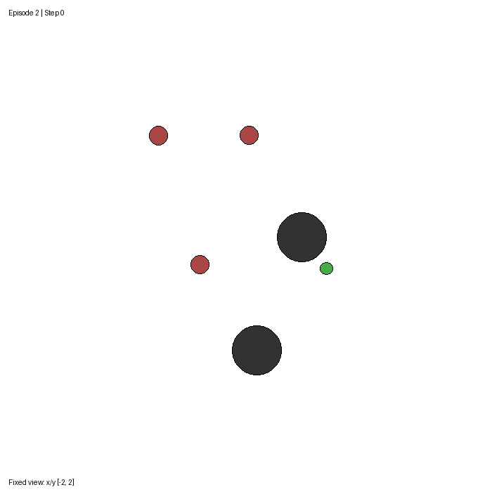
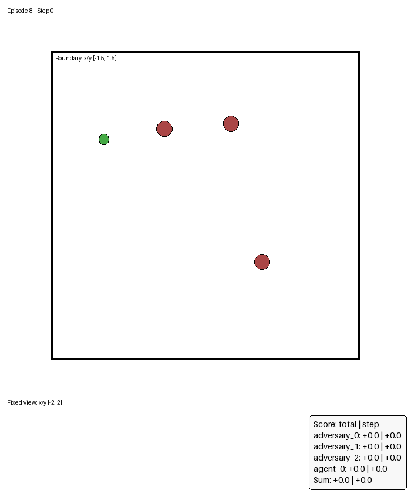
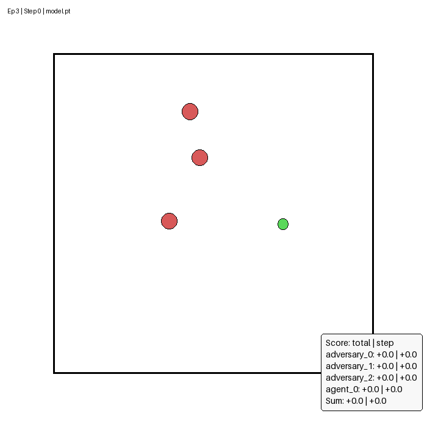
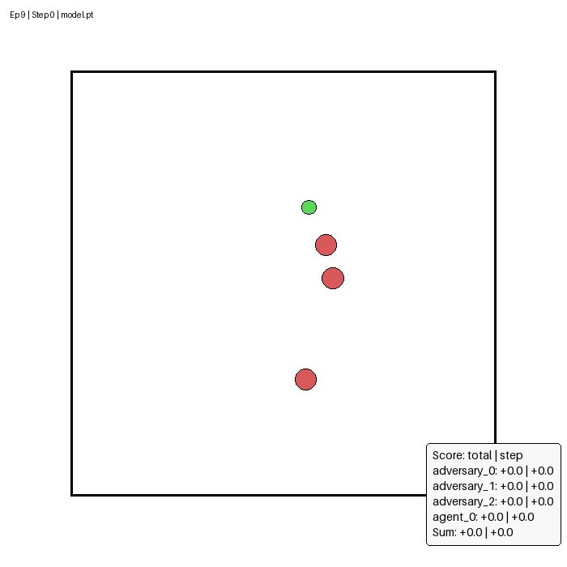
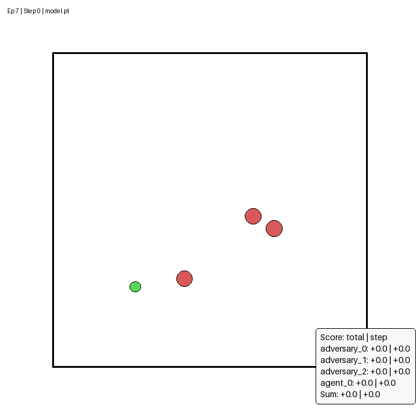
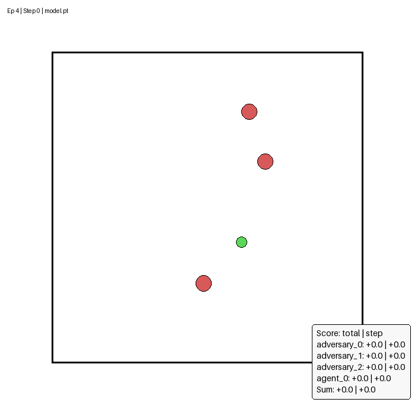
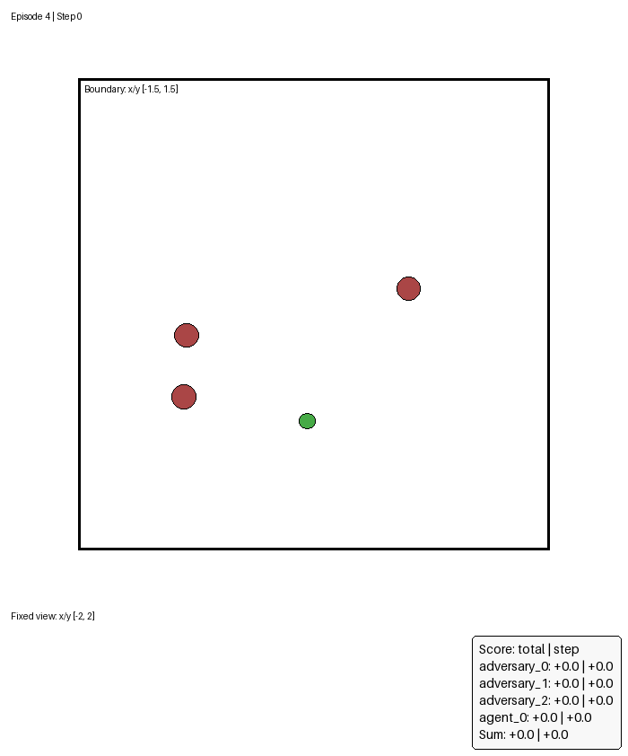
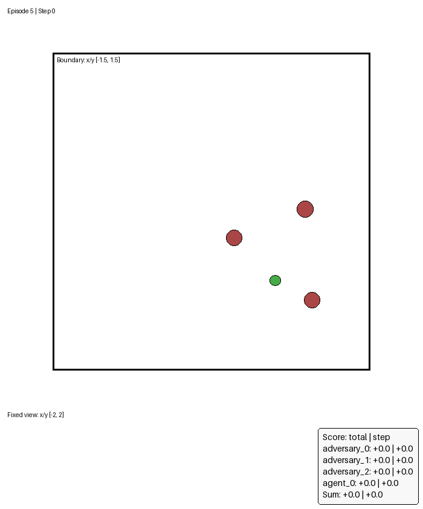

# maddpg with PyTorch and PettingZoo

The original version of [MADDPG](https://arxiv.org/pdf/1706.02275.pdf)
use environment of  [multiagent-particle-envs](https://github.com/openai/multiagent-particle-envs),
which has no longer been updated.
A maintained version of these environments is provided
by [PettingZoo](https://github.com/Farama-Foundation/PettingZoo).
So this repository implement MADDPG using PyTorch and PettingZoo

# Usage

training and evaluation is simple and straightforward, take `simple_tag` for example:

```shell
python main.py simple_tag_v3  # training; automatically prefer CUDA
python evaluate.py simple_tag_v3 1  # evaluate result saved in folder 1
```

more details about arguments can be found in `main.py`, `evaluate.py`
or simply run `python main.py --help`, `python evaluate.py --help`

## GPU and CPU selection

Use the existing Python environment with CUDA-enabled PyTorch and `mpe2` installed.
The original `requirements.txt` lists legacy versions; do not reinstall it into
the working environment for this updated code.

```shell
python main.py simple_adversary_v3 --device cuda
python main.py simple_adversary_v3 --device cpu
python evaluate.py simple_adversary_v3 1 --device cuda
```

The default `--device auto` selects CUDA when available and otherwise uses CPU.
An explicitly requested CUDA device fails clearly if unavailable. The startup
message shows the selected device and GPU name. All four networks per agent,
sampled training batches, and observations for action selection use that device.
Replay data remains in system RAM and only sampled batches move to the GPU.
Saved actors can be loaded on CPU or GPU using the evaluation `--device` flag.
Per-step action logging is disabled at the default INFO level to reduce disk I/O.

The MPE environment simulation still runs on CPU. By default the first 50,000
steps collect random actions without training, then updates occur every 100 steps.
These small networks may therefore show brief GPU activity rather than continuous
high utilization. View CUDA/Compute activity or use `nvidia-smi` when monitoring.

For a short training check (writes a separate results folder):

```shell
python main.py simple_adversary_v3 --device cuda --episode_num 3 --episode_length 5 --random_steps 0 --learn_interval 1 --batch_size 4 --buffer_capacity 64
```

Restart the training process to use changed code. The saved `model.pt` contains
actors for evaluation; it is not a full training-resume checkpoint.

# Result

|  configuration   | episodes                        | evaluation result                                    | running time(s)
|  ----  |------------------------------------------------------|------------------------------------------------------|---|
| baseline | 5000 |  |346
| bounce  | 5000  |  | 435
| punish k=0.5  | 5000|  |408
| punish k=1  | 5000 |  | 429
| punish k=5  | 5000 |   | 427
| punish k=10  | 5000  |  | 415
| punish b=5  | 2000   | |208
| punish b=5   | 5000 |  |534


# reference

- implementation of [openai](https://github.com/openai/maddpg)
- implementation of [shariqiqbal2810](https://github.com/openai/maddpg)
- [maddpg-mpe-pytorch](https://github.com/Git-123-Hub/maddpg-mpe-pytorch)


## simple_tag 有界环境与测评

`main.py`、`evaluate.py`、`evaluate_backup.py` 使用本地 `simple_tag_boundary.py`，无需修改安装的 MPE2。默认场地为 `[-1.5, 1.5] × [-1.5, 1.5]`，用 `--boundary-range R` 改为 `[-R, R] × [-R, R]`。边界按圆形物体外缘判断，中心坐标限制在 `[-R + size, R - size]`，保证整个物体处于场地内。固定障碍物在重置时也保证位于场地内。

训练和两个评估入口均支持以下选项（也支持将参数名中的短横线改为下划线）：

| 参数 | 默认值 | 含义 |
| --- | --- | --- |
| `--boundary-mode` | `bounce` | `bounce` 反弹或 `punish` 触边惩罚 |
| `--boundary-range` | `1.5` | 正方形场地半宽，必须大于所有物体半径 |
| `--boundary-penalty` | `100.0` | punish 模式下每个触边智能体每步扣分值 |
| `--num-obstacles` | `2` | simple_tag 障碍物数量；设为 0 即无障碍物 |

无障碍物训练：`python main.py simple_tag_v3 --num-obstacles 0`。障碍物数量会保存到 run_config.json，评估自动继承，也可显式传入 `--num-obstacles 0`。旧配置未记录数量时默认 2。移除障碍物会改变观测维度，需要重新训练无障碍物模型；不能将原来含障碍物的模型直接用于此模式。其他环境不受此选项影响。

`bounce`：触边时位置截回边缘，朝墙外的法向速度分量反向，切向分量保持不变；角落同时处理两个分量。不额外扣触边分。速度仍受 MPE 原有阻尼、动作和速度上限影响。

`punish`：同样限制物体在场地内，截回边缘并清零朝墙外的法向速度分量；每个仍触边的智能体每步扣指定分数。角落只扣一次，离开边界后停止扣分，惩罚仅作用于触边者。两种模式均允许朝场地内部移动。

逃跑者原先从 0.9 开始的边缘惩罚已替换。原有捕获奖励保持：逃跑者每步每接触一个追捕者扣 10 分；追捕者共享每个捕获接触对的 +10 奖励，再减去 punish 模式下各自的触边惩罚。捕获不提前结束回合，训练和评估仍按 `episode_length` 运行。

```powershell
Set-Location 'C:\Users\WEI\Desktop\code\maddpg-gpu-update'
conda activate dlrl
python main.py simple_tag_v3 --boundary-mode bounce --episode_length 500
python main.py simple_tag_v3 --boundary-mode punish --boundary-penalty 100 --boundary-range 1.5
python evaluate.py simple_tag_v3 1 --episode-num 100 --episode-length 500 --boundary-mode bounce
python evaluate.py simple_tag_v3 1 --episode-num 100 --boundary-mode punish --boundary-penalty 100
```

新训练的参数写入结果目录的 `run_config.json`。评估的边界参数优先级为：显式命令行参数 > 该模型保存的训练设置 > 默认值。旧模型没有配置文件时默认使用 bounce、范围 1.5、惩罚 100；可显式指定覆盖。已有配置中的旧惩罚值会保留，评估时加 `--boundary-penalty 100` 即可覆盖。评估相机 `--camera-range` 必须不小于场地半宽。旧模型可以加载，建议重新训练以适应新的物理边界。

### 三项测评指标（仅 simple_tag_v3）

捕获使用原环境的碰撞规则：逃跑者与任一追捕者的中心距离 **小于两者半径之和**。在每个完整环境步结束后检查，步数从 1 开始。每个逃跑者仅记首次捕获；之后脱离接触也不算逃逸。初始状态不单独计数，第一次动作后的状态作为第 1 步。

| 指标字段 | 定义 |
| --- | --- |
| `adversary_capture_success_rate` | 捕获成功回合数 / 总评估回合数 |
| `average_capture_steps` | 仅在捕获成功回合中，首次完成捕获所需步数的平均值；无成功回合时为 JSON `null`，控制台显示 N/A |
| `agent_escape_success_rate` | 整个回合从未被捕获的逃跑者数量 / 所有回合逃跑者总数量 |

默认只有一个逃跑者，捕获成功率和逃逸成功率互补。若通过 Python API 增加逃跑者数量，团队成功定义为该回合所有逃跑者都至少被捕获一次（无需同时）；成功步数是最后一个逃跑者首次被捕获的步数，逃逸仍按个体统计。

`evaluate.py` 的每个新评估目录除 GIF、奖励 CSV 和奖励曲线外，新增 `evaluation_metrics.csv`（逐回合成功状态、捕获步数、逃逸数、各逃跑者首次捕获步数）与 `evaluation_summary.json`（上述三项汇总和边界设置）。成功率在文件中保存为 0～1，控制台显示百分比；失败回合捕获步数为空，不混入平均值。`evaluate_backup.py` 也输出同名指标文件到模型目录，重复运行会更新这些指标文件。

折现因子默认仍为 `gamma=0.95`。`python check_boundary_rewards.py` 可验证边界、奖励、统计和 PettingZoo 接口。需要兼容的运行依赖：NumPy、PyTorch、MPE2、PettingZoo、Gymnasium、pygame-ce、Matplotlib 和 Pillow；当前 MPE2 1.1.1 需要提供 `AgentSelector` 的较新 PettingZoo（例如 1.26.1）。

## Branch Notice: Alternative Implementation

The boundary constraint mechanisms discussed above represent the primary approach used in the `main` branch.

To explore alternative technical routes, a separate independent development branch named **`dev-alternative`** was also created. It independently reproduces the MADDPG algorithm and implements a comparative study of boundary constraints (Soft Penalty vs. Hard Physical Rebound). Please switch to the `dev-alternative` branch to view its specific implementation and evaluation scripts (`main_rebound.py`, `main_penalty.py`).
